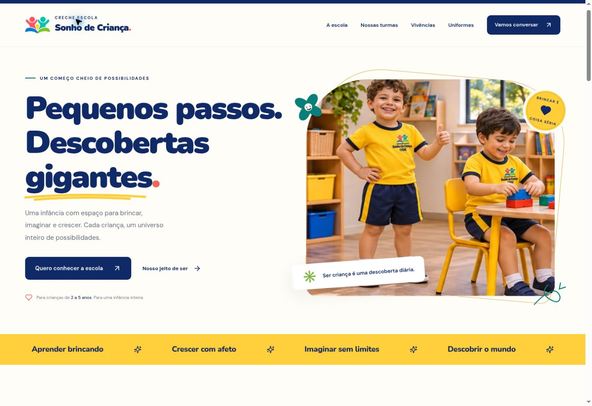
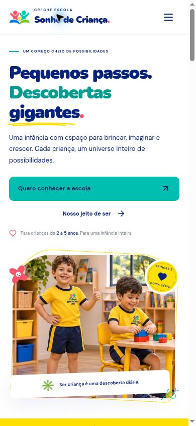
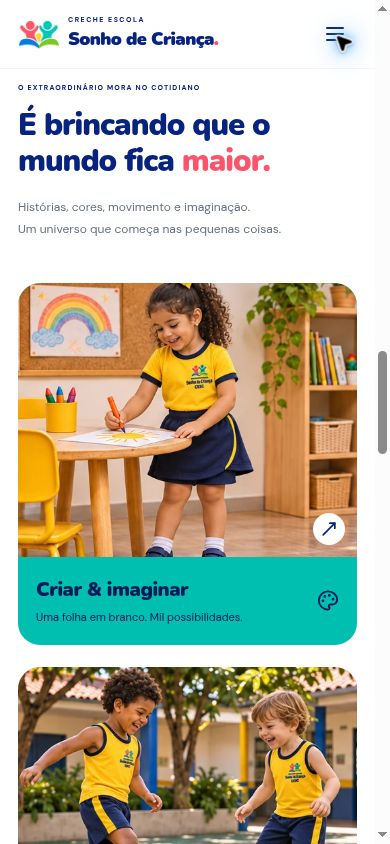

# Creche Escola Sonho de Criança

Site institucional para educação infantil, de 2 a 5 anos. Primeira versão visual construída a partir da marca, dos uniformes e das imagens conceituais fornecidas por Vitor Alves.



## Desenvolvimento

Node.js 22.12+ e npm.

```sh
npm ci
npm run dev
```

```sh
npm run build
npm run preview
```

Base: React 19 + Vite 7 + Tailwind CSS 4 + ícones Lucide. Layout responsivo, navegação por âncoras, seletor de faixas etárias, galeria ampliável e perguntas frequentes. Fontes Nunito e DM Sans via Google Fonts, com fallback local do sistema.

## Alterações

- `src/school.js`: dados oficiais e textos das faixas etárias.
- `src/main.jsx`: textos, seções e comportamento da página.
- `src/styles.css`: cores, tipografia e layout, incluindo celular.
- `public/images/`: imagens fornecidas e marca.

Preencha WhatsApp com DDI e DDD, apenas dígitos, para habilitar a continuação da mensagem no WhatsApp. Sem telefone cadastrado, o site permite somente preparar e copiar o texto, explicando que nada foi enviado. O formulário não possui backend, não armazena dados e não coleta nome da criança. Não usa Analytics ou cookies próprios.

## Publicação

O workflow `.github/workflows/deploy.yml` compila e publica a cada push em `main`. Em **Settings → Pages → Build and deployment**, selecione **GitHub Actions**. A base relativa do Vite funciona tanto no caminho do repositório quanto em um futuro domínio próprio. Não foi reutilizado o domínio, formulário ou Analytics do portfólio pessoal.

## Antes da divulgação institucional

Confirmar com a direção: endereço, contato, turnos, organização das turmas e proposta pedagógica. Os textos atuais são sugestões editoriais para avaliação. Não há depoimentos, estatísticas, serviços ou infraestrutura inventados. As imagens com crianças e uniformes são conceitos feitos com IA; o site as identifica como ilustrações. Substituir ou complementar com fotografias autorizadas quando disponíveis.

## Referências de estrutura

- https://www.escoladavila.com.br/educacao-infantil — apresentação da infância e caminho para conhecer a escola.
- https://espacobrincar.com.br/ — clareza na apresentação da proposta e das vivências.

As referências orientaram a organização do conteúdo. Identidade, composição e textos desta versão são próprios; nenhum material visual dessas escolas foi reutilizado.

## Validação técnica desta versão

Build de produção aprovado localmente e no GitHub Actions. Navegação por idade, abertura/fechamento da galeria, FAQ e geração da mensagem conferidos no navegador. A publicação depende de habilitar GitHub Pages com origem GitHub Actions nas configurações do repositório.

A auditoria de dependências em 17/11/2026 apontou o aviso GHSA-fc5q-39xc-vjpf em `picomatch`, transitivo das ferramentas de desenvolvimento; o mantenedor ainda não publicou correção. A página publicada é estática e não recebe padrões glob dos visitantes. O Vite está em 7.3.8, com mínimo configurado nessa versão; não aplicar o downgrade automático sugerido por npm audit para Vite 6.2.7. Referência: https://github.com/advisories/GHSA-fc5q-39xc-vjpf

## Ajuste para smartphones

Layout revisado em larguras de 320, 390 e 768 pixels no navegador: menu, limites horizontais, galeria e navegação entre seções. Cabeçalho e título compactos, imagens recortadas sem esticamento, cartões menores e faixa de valores em duas colunas no celular. As imagens são recortadas em SVG a partir dos arquivos originais, preservando a proporção em qualquer formato de tela.



